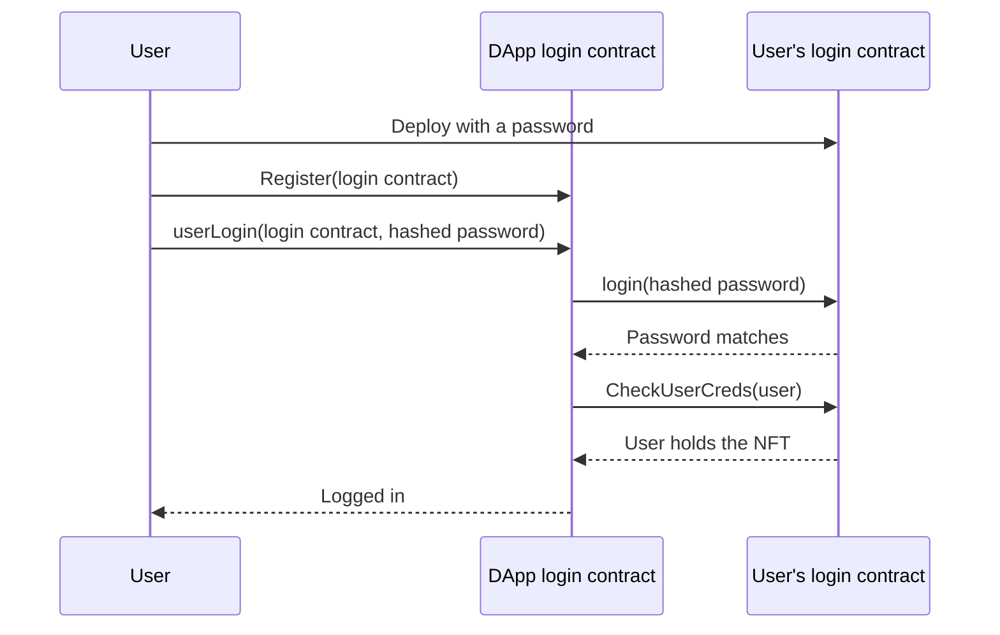

<p align="center">
  
</p>

<p align="center">
  
<a href="https://github.com/CoinClubQuincy/LoginMFAContract/actions/workflows/build.yml"></a>        
</p>

<p align="center">
  <a href="#how-it-works">How it works</a> · <a href="#try-it">Try it</a> · <a href="#what-is-tested">What is tested</a> · <a href="#known-issues">Known issues</a>
</p>

A user deploys their own login contract, which stores a password hash and mints credential NFTs. A DApp then checks both factors against that contract, so the user never hands a password to the DApp's own database.

> [!CAUTION]
> Contract storage and transaction data are public. On a public chain the password hash can be read and replayed, which leaves the **NFT as the only real factor**. Don't reuse a real password here. See [Known issues](#known-issues).

## How it works




| Contract | Use |
| --- | --- |
| `contracts/Public/PublicLoginContract.sol` | Public networks. Stores one hash, and the DApp path takes a hashed password |
| `contracts/Private/PrivateLoginContract.sol` | Private networks. Stores the value and compares a single hash |

| Function | What it does |
| --- | --- |
| `PublicLoginContract.login(hash)` | Checks the password factor |
| `PublicLoginContract.CheckUserCreds(user)` | Checks that the user holds a credential NFT |
| `PublicLoginContract.Edit(newPassword)` | Changes the password. The caller needs 3 of the 5 credential NFTs |
| `PublicLoginContract.Burn(amount, account)` | Burns compromised credentials. The caller needs 3 NFTs |
| `PublicDAppLoginContract.Register(login)` | Adds a user's login contract to the DApp |
| `PublicDAppLoginContract.userLogin(login, hash)` | Logs in when both factors pass |

## Try it

```bash
git clone https://github.com/CoinClubQuincy/LoginMFAContract.git
cd LoginMFAContract
git clone --depth 1 -b v4.9.6 https://github.com/OpenZeppelin/openzeppelin-contracts lib/openzeppelin-contracts
git clone --depth 1 -b v1.9.7 https://github.com/foundry-rs/forge-std lib/forge-std
forge test
```

You need [Foundry](https://getfoundry.sh). Tests named `test_KnownIssue_*` pass because they pin a defect, so a passing run does not mean the defect is gone.

To try it on a network, use the Apothem testnet:

| Network | Chain ID | RPC |
| --- | --- | --- |
| Apothem testnet | 51 | `https://rpc.apothem.network` |
| XDC mainnet | 50 | `https://rpc.xinfin.network` |

```bash
forge create contracts/Public/PublicLoginContract.sol:PublicLoginContract --rpc-url https://rpc.apothem.network --interactive --broadcast --legacy \
  --constructor-args "a-demo-password" "https://example.com/{id}.json"
```

## What is tested

[`test/foundry/Login.t.sol`](test/foundry/Login.t.sol) has 7 tests of the public contracts and runs in CI on every push.

| Tested | Not tested |
| --- | --- |
| Logging in with the NFT and hashed password | The `Private` contracts, which are only compiled |
| A plain password, a wrong password or a missing NFT failing | A real network, testnet or mainnet |
| An unregistered login contract being refused | An independent security audit |
| 3 NFTs being needed to change the password | The older Truffle tests, which were not run |

## Known issues

| Issue | Effect | Test |
| --- | --- | --- |
| The stored hash passes the password check | Anyone can read it from storage and pass it to `login()`, so the password adds little on a public chain | `test_StoredHashAloneBeatsThePasswordCheck` |
| Login arguments are public | `userLogin` is a transaction, so its hash argument is visible on-chain | Read from the code |

<details>
<summary><strong>More XDC projects</strong></summary>

| Group | Project | What it is |
| --- | --- | --- |
| Standards | [XRC-SHARES](https://github.com/CoinClubQuincy/XRC-SHARES) | Dividend-paying NFT shares and SPLITS for a DApp |
| Standards | [XRCDividendPlus](https://github.com/CoinClubQuincy/XRCDividendPlus) | Dividend-paying XRC-20 token |
| Treasury and finance | [Multi-Sig-Treasury](https://github.com/CoinClubQuincy/Multi-Sig-Treasury) | Treasury controlled by tokenized keys |
| Treasury and finance | [XRC-Airdrop](https://github.com/CoinClubQuincy/XRC-Airdrop) | Self-run token airdrop |
| Treasury and finance | [XRC-Credit](https://github.com/CoinClubQuincy/XRC-Credit) | Debt contract skeleton |
| Treasury and finance | [XDC-Defi-Instruments](https://github.com/CoinClubQuincy/XDC-Defi-Instruments) | Assets, agreements, forwards, futures and a marketplace |
| Identity and access | [PrivateAccessToken](https://github.com/CoinClubQuincy/PrivateAccessToken) | Token-gated contract data demo |
| Identity and access | [Delegated_Authority](https://github.com/CoinClubQuincy/Delegated_Authority) | KYC notary proof of concept |
| Learning and libraries | [XDC-LemonadeStand](https://github.com/CoinClubQuincy/XDC-LemonadeStand) | Workshop DApp built on XRC-SHARES |
| Learning and libraries | [Non-Financial-SmartContracts](https://github.com/CoinClubQuincy/Non-Financial-SmartContracts) | Games, inventory, keys and on-chain repositories |
| Tools | [XDC_Python_SDK_V1](https://github.com/CoinClubQuincy/XDC_Python_SDK_V1) | Python client for the XDC JSON-RPC API |
| Tools | [PrivateXDCNode_SetupScript](https://github.com/CoinClubQuincy/PrivateXDCNode_SetupScript) | Private XDC network setup scripts |
| Tools | [WebApp_to_XDCPay](https://github.com/CoinClubQuincy/WebApp_to_XDCPay) | Web app to XDCPay tutorial |
| Multi-chain | [CoinClub_Framework](https://github.com/CoinClubQuincy/CoinClub_Framework) | Python library with an XDC adapter |
| Interfaces | [Contract_Interface_Model_Language](https://github.com/CoinClubQuincy/Contract_Interface_Model_Language) | Interface documents for smart contracts and APIs |

</details>

## License

[MIT](LICENSE).
