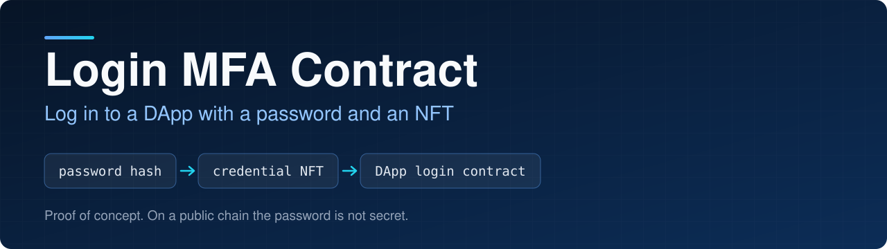
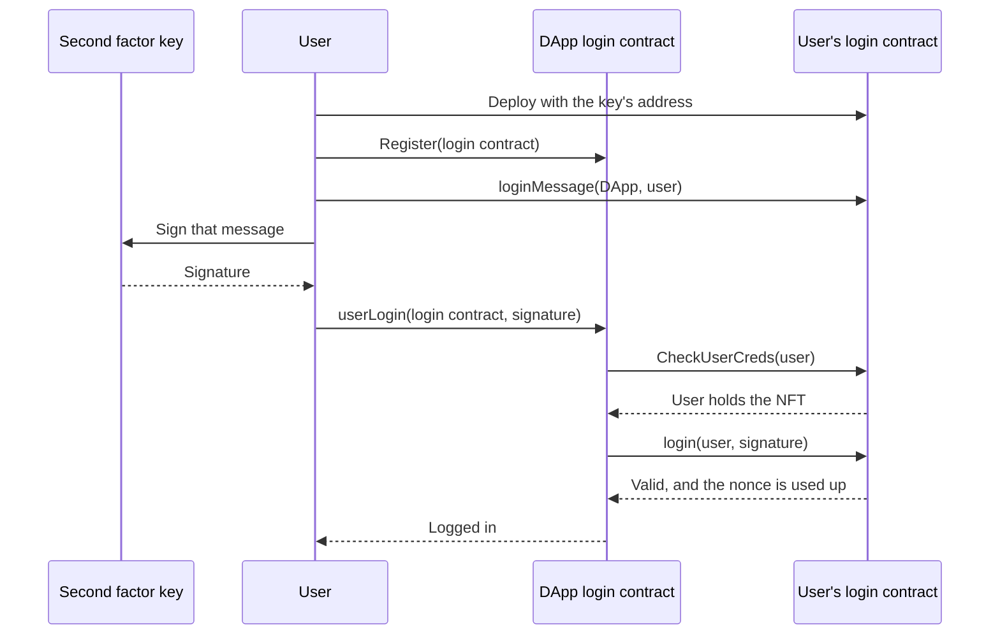

<p align="center">
  
</p>

<p align="center">
  
<a href="https://github.com/CoinClubQuincy/LoginMFAContract/actions/workflows/build.yml"></a>        
</p>

<p align="center">
  <a href="#how-it-works">How it works</a> · <a href="#try-it">Try it</a> · <a href="#what-is-tested">What is tested</a> · <a href="#known-issues">Known issues</a>
</p>

A user deploys their own login contract, which mints credential NFTs and names a second factor key. To log in to a DApp, the user must hold an NFT and present a signature from that key. The DApp never sees or stores a password.

> [!CAUTION]
> This contract has not been audited and has not run on a real network. Anyone can deploy a login contract, so a successful login only proves control of the one you named. See [Known issues](#known-issues).

## How it works




The signature covers the login contract, the DApp, the user, a nonce and the chain ID. It works once, for that user at that DApp, on that chain. Copying it from a pending transaction gains nothing, because a different sender makes it invalid. Only the DApp can use up a signature meant for it.

| Contract | Use |
| --- | --- |
| `contracts/Public/PublicLoginContract.sol` | Public networks. Stores no secret |
| `contracts/Private/PrivateLoginContract.sol` | Private networks only. Stores a password in plain text that anyone who can read chain state can see |

| Function | What it does |
| --- | --- |
| `PublicLoginContract.loginMessage(dapp, user)` | The hash the second factor key signs with `personal_sign` |
| `PublicLoginContract.User_Login(dapp, signature)` | Tests a signature without using it up. The caller needs an NFT |
| `PublicLoginContract.login(user, signature)` | Called by the DApp. Checks the signature and uses up the nonce |
| `PublicLoginContract.CheckUserCreds(user)` | Checks that the user holds a credential NFT |
| `PublicLoginContract.Edit(newSecondFactor)` | Replaces the key. The caller needs 3 of the 5 credential NFTs |
| `PublicLoginContract.Burn(amount, account)` | Burns credentials from any account, without its consent, so stolen ones can be cancelled. The caller needs 3 NFTs |
| `PublicDAppLoginContract.Register(login)` | Adds a user's login contract to the DApp |
| `PublicDAppLoginContract.userLogin(login, signature)` | Logs the caller in when both factors pass |
| `PublicDAppLoginContract.LoginStatus(login, user)` | Whether that user is logged in. Moving or losing any of the NFTs ends the session, even if they come back |
| `PublicDAppLoginContract.Logout(login, user)` | Logs the caller out |

The page under `Web3/` is an unwired mockup. Its script file is empty and it still shows a password field.

## Try it

```bash
git clone https://github.com/CoinClubQuincy/LoginMFAContract.git
cd LoginMFAContract
git clone --depth 1 -b v4.9.6 https://github.com/OpenZeppelin/openzeppelin-contracts lib/openzeppelin-contracts
git clone --depth 1 -b v1.9.7 https://github.com/foundry-rs/forge-std lib/forge-std
forge test
```

You need [Foundry](https://getfoundry.sh).

To try it on a network, use the Apothem testnet:

| Network | Chain ID | RPC |
| --- | --- | --- |
| Apothem testnet | 51 | `https://rpc.apothem.network` |
| XDC mainnet | 50 | `https://rpc.xinfin.network` |

```bash
forge create contracts/Public/PublicLoginContract.sol:PublicLoginContract --rpc-url https://rpc.apothem.network --interactive --broadcast --legacy \
  --constructor-args 0xYourSecondFactorAddress "https://example.com/{id}.json"
```

## What is tested

[`test/foundry/Login.t.sol`](test/foundry/Login.t.sol) has 27 tests and runs in CI on every push.

| Tested | Not tested |
| --- | --- |
| Logging in with a token and a signature, and single use | A real network, testnet or mainnet |
| Wrong key, malformed signature, no token | An independent security audit |
| A signature copied by another sender, or used for another DApp or chain | A real wallet signing the message |
| Nobody else using up a signature | |
| Sessions being per user, logging out only yourself, and moving tokens ending a session for good | |
| Replacing the key and burning credentials needing 3 tokens | |
| The private contracts, including their password being readable from storage | |

## Changes from earlier versions

Contracts already deployed are unaffected and keep the old behaviour.

- The public contracts no longer use a password. The constructor and `Edit` take an address, and `userLogin`, `login` and `User_Login` take a signature. `ViewData` was removed in favour of the public `secondFactor`.
- A session used to come back if the tokens left and returned. Moving a token now ends it, using the new `sessionEpoch`, which login contracts must provide.
- `login` is no longer a view, because it uses up a nonce.
- `LoginStatus` now takes a user, in both variants. It used to report one status per login contract, shared by every holder.
- `Logout` can only be called by the user it logs out, in both variants. Anyone holding nothing could log someone out before.
- `Burn` no longer returns placeholder text.
- On the private contract, `User_Login` now works with one token. It needed 3 by accident.
- Tracked `node_modules`, build output and the older Truffle test were removed.

## Known issues

| Issue | Effect |
| --- | --- |
| Anyone can deploy a login contract | A login proves control of the named contract and nothing more. A DApp must decide which login contracts it trusts |
| Three tokens control everything | Whoever holds 3 can replace the key and burn anyone's tokens. Keep them apart from the key |
| A lost second factor key needs 3 tokens to replace | Without them, nobody can log in again |
| A session survives a key change | Replacing the key does not log people out. Only moving or losing the tokens, or logging out, does |
| The private contract's password is readable | Anyone who can read that network's chain state can read it, as a test shows |

<details>
<summary><strong>More XDC and EVM projects</strong></summary>

| Group | Project | What it is |
| --- | --- | --- |
| Standards | [XRC-SHARES](https://github.com/CoinClubQuincy/XRC-SHARES) | Dividend-paying NFT shares and SPLITS for a DApp |
| Standards | [XRCDividendPlus](https://github.com/CoinClubQuincy/XRCDividendPlus) | Dividend-paying XRC-20 token |
| Treasury and finance | [Multi-Sig-Treasury](https://github.com/CoinClubQuincy/Multi-Sig-Treasury) | Treasury controlled by tokenized keys |
| Treasury and finance | [XRC-Airdrop](https://github.com/CoinClubQuincy/XRC-Airdrop) | Self-run token airdrop |
| Treasury and finance | [XRC-Credit](https://github.com/CoinClubQuincy/XRC-Credit) | Single-loan credit contract |
| Treasury and finance | [XDC-Defi-Instruments](https://github.com/CoinClubQuincy/XDC-Defi-Instruments) | Assets, agreements, forwards, futures and a marketplace |
| Treasury and finance | [XRC1155-Equities-Market](https://github.com/CoinClubQuincy/XRC1155-Equities-Market) | Shares, portfolios and a marketplace on ERC-1155 |
| Treasury and finance | [NFTOTC](https://github.com/CoinClubQuincy/NFTOTC) | Over-the-counter sale of a token collection |
| Treasury and finance | [DAppProxySwap](https://github.com/CoinClubQuincy/DAppProxySwap) | Currency swaps for a DApp through a fixed router |
| Identity and access | [PrivateAccessToken](https://github.com/CoinClubQuincy/PrivateAccessToken) | Token access to encrypted off-chain data |
| Identity and access | [Delegated_Authority](https://github.com/CoinClubQuincy/Delegated_Authority) | KYC notary proof of concept |
| Identity and access | [EncryptedNFT-Documents](https://github.com/CoinClubQuincy/EncryptedNFT-Documents) | NFTs tied to encrypted off-chain documents |
| Learning and libraries | [XDC-LemonadeStand](https://github.com/CoinClubQuincy/XDC-LemonadeStand) | Workshop DApp built on XRC-SHARES |
| Learning and libraries | [Non-Financial-SmartContracts](https://github.com/CoinClubQuincy/Non-Financial-SmartContracts) | Games, inventory, keys and on-chain repositories |
| Learning and libraries | [ContractLedger](https://github.com/CoinClubQuincy/ContractLedger) | On-chain list of contract addresses |
| Learning and libraries | [TimestampConverter](https://github.com/CoinClubQuincy/TimestampConverter) | Timestamps to calendar dates in Solidity |
| Tools | [XDC_Python_SDK_V1](https://github.com/CoinClubQuincy/XDC_Python_SDK_V1) | Python client for the XDC JSON-RPC API |
| Tools | [PrivateXDCNode_SetupScript](https://github.com/CoinClubQuincy/PrivateXDCNode_SetupScript) | Private XDC network setup scripts |
| Tools | [WebApp_to_XDCPay](https://github.com/CoinClubQuincy/WebApp_to_XDCPay) | Working web app connected to XDCPay |
| Multi-chain | [CoinClub_Framework](https://github.com/CoinClubQuincy/CoinClub_Framework) | Python library with an XDC adapter |
| Interfaces | [Contract_Interface_Model_Language](https://github.com/CoinClubQuincy/Contract_Interface_Model_Language) | Interface documents for smart contracts and APIs |

</details>

## License

[MIT](LICENSE).
